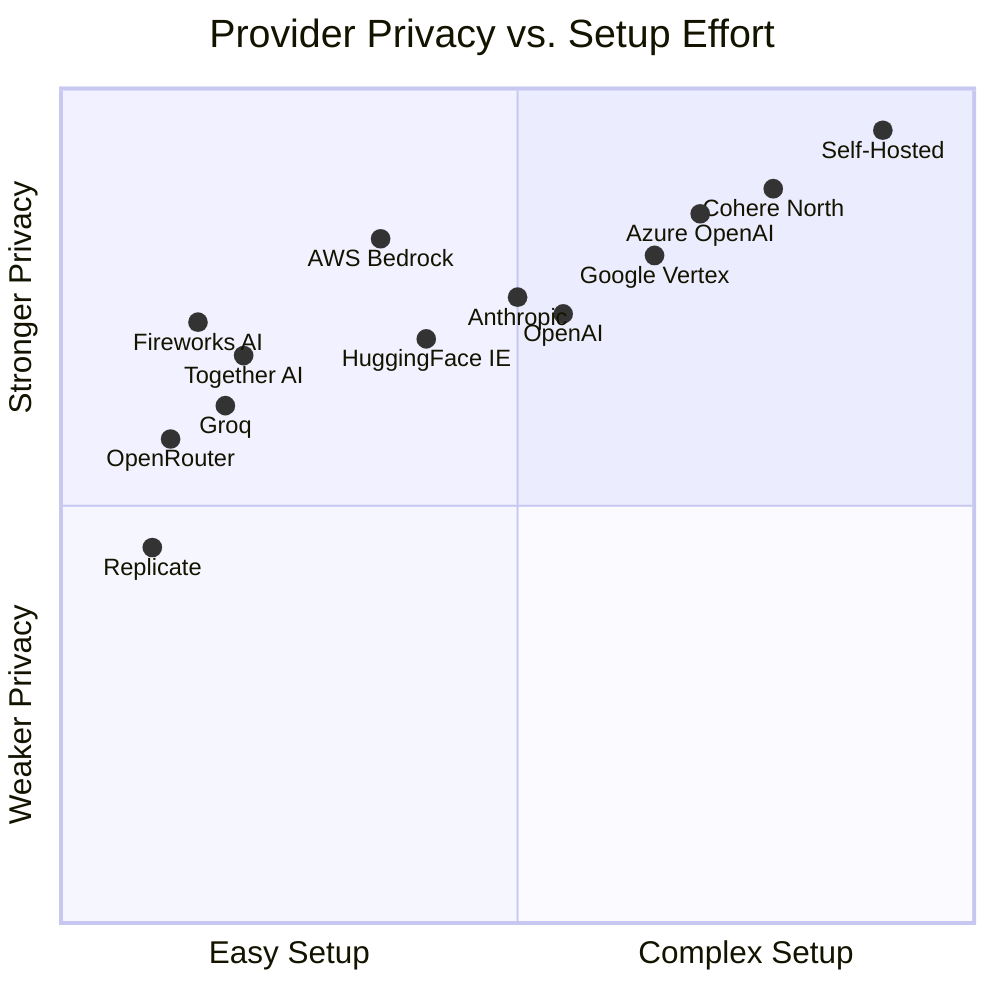
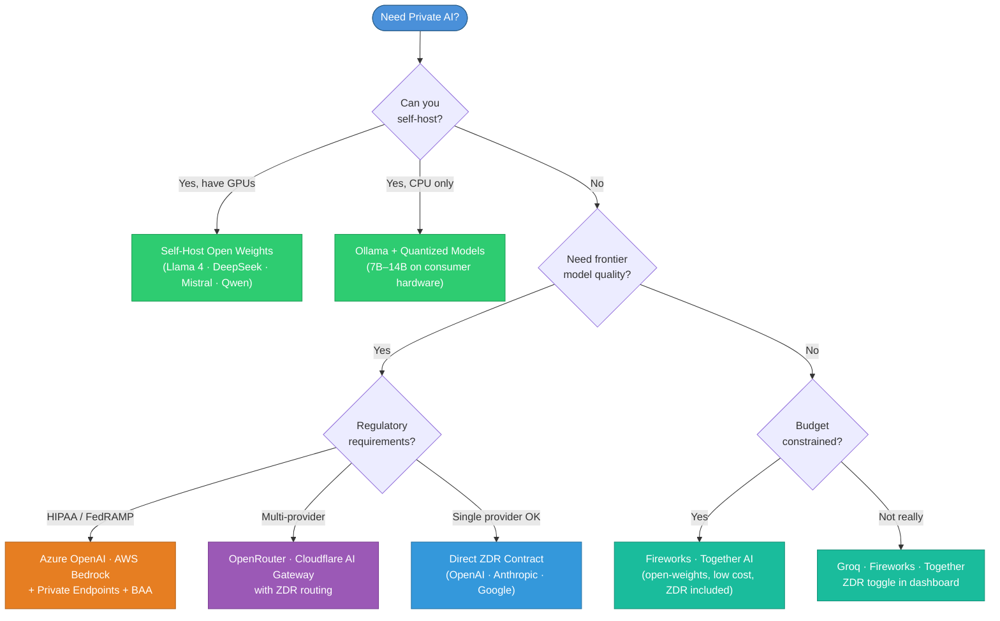

# Zero Data Retention (ZDR) for LLM Providers

A practical reference for keeping your data private when you use LLM APIs: which providers offer zero data retention, how to turn it on, what it does not cover, and how to prove it to an auditor. Written for engineers in regulated industries.

> **Last checked:** April 2026. Provider terms change often; every page links to the official source, so check it before you rely on a detail. A [web version](https://abubakar-siddik.com/guides/zero-data-retention-llm-providers) with rendered diagrams lives on my site and is updated first.

## Contents

- [Quick answer: who offers ZDR](#quick-answer-who-offers-zdr)
- [Which approach is right for me?](#which-approach-is-right-for-me)
- [Providers](#providers)
- [Topics](#topics)
- [In-depth guides](#in-depth-guides)
- [Maintainer](#maintainer)
- [Contributing](#contributing)

## Quick answer: who offers ZDR

| Provider | Default Retention | ZDR Mechanism | How to Enable | Private Networking | Compliance |
| :--- | :--- | :--- | :--- | :--- | :--- |
| **[OpenAI](providers/openai.md)** | 30 days (abuse) | ZDR / MAM | Sales approval → Dashboard | Public SaaS (data residency available) | SOC 2 |
| **[Anthropic](providers/anthropic.md)** | 7 days | ZDR Arrangement | Enterprise contract | Public SaaS | SOC 2, HIPAA (BAA) |
| **[Google Vertex AI](providers/google-vertex-ai.md)** | 24h cache | Abuse monitoring exception | Support request / invoiced billing | VPC Service Controls, Private Google Access | SOC 2, HIPAA, ISO 27001 |
| **[Azure OpenAI](providers/azure-openai.md)** | 30 days (abuse) | Abuse monitoring opt-out | Support ticket (EA/MCA required) | Azure Private Endpoints | SOC 2, HIPAA, FedRAMP |
| **[AWS Bedrock](providers/aws-bedrock.md)** | **None (ZDR default)** | Default | No action needed | AWS PrivateLink | SOC 2, HIPAA, FedRAMP |
| **[Mistral AI](providers/mistral-ai.md)** | 30 days | ZDR toggle | Account setting | Self-host open-weights | GDPR |
| **[Groq](providers/groq.md)** | 30 days | ZDR toggle | Dashboard Data Controls | Public SaaS | SOC 2 |
| **[Fireworks AI](providers/fireworks-ai.md)** | **None (ZDR default)** | Default | No action needed | Public SaaS | SOC 2, HIPAA |
| **[Together AI](providers/together-ai.md)** | Configurable | ZDR toggle | Privacy settings | VPC deployment available | SOC 2, HIPAA |
| **[Cohere](providers/cohere.md)** | 30 days (SaaS) | Enterprise ZDR / Private deploy | Enterprise contract / North platform | On-prem, VPC, air-gapped | SOC 2, ISO 27001, GDPR |
| **[HuggingFace IE](providers/hugging-face-inference-endpoints.md)** | No payloads stored | Default (no payload storage) | N/A | AWS/Azure PrivateLink | SOC 2 Type 2, GDPR |
| **[Replicate](providers/replicate.md)** | 1 hour (API) | Auto-deletion | Default for API | Public SaaS | — |
| **[OpenRouter](providers/openrouter.md)** | No prompts stored | ZDR provider routing | Dashboard or per-request flag | Public SaaS | — |
| **[DeepSeek](providers/chinese-and-international.md)** | N/A (self-host) | Self-hosting (MIT) | Deploy on your infra | Full VPC isolation | Your responsibility |

## Which approach is right for me?

"Zero-retention" is not a single feature — it is a **bundle of technical controls + contract terms** ensuring customer content (prompts, outputs, files) is not stored at rest by the vendor. Different approaches offer different trade-offs:

### Approach Comparison

| Approach | Privacy Strength | Model Quality | Operational Cost | Setup Complexity |
| :--- | :--- | :--- | :--- | :--- |
| **Self-hosted (air-gapped)** | Strongest | Open-weight only | Hardware + ops | High |
| **Self-hosted (VPC)** | Very strong | Open-weight only | Cloud GPU cost | Medium |
| **Cloud ZDR + Private Link** | Strong (contractual) | Frontier models | API pricing | Low-Medium |
| **SaaS ZDR API** | Good (contractual) | Frontier models | API pricing | Low |
| **Gateway with ZDR routing** | Good (delegated) | Multi-provider | API + gateway fee | Low |

## Providers

One page per provider: default retention, how to enable ZDR, what is and isn't covered, and code where it helps.

| Frontier and cloud | Open-model inference | Gateways and others |
| :--- | :--- | :--- |
| [OpenAI](providers/openai.md) | [Fireworks AI](providers/fireworks-ai.md) | [OpenRouter](providers/openrouter.md) |
| [Anthropic](providers/anthropic.md) | [Together AI](providers/together-ai.md) | [Other AI gateways](providers/gateways.md) |
| [Google Vertex AI](providers/google-vertex-ai.md) | [Groq](providers/groq.md) | [Replicate](providers/replicate.md) |
| [Azure OpenAI](providers/azure-openai.md) | [Hugging Face Inference Endpoints](providers/hugging-face-inference-endpoints.md) | [Chinese and international providers](providers/chinese-and-international.md) |
| [AWS Bedrock](providers/aws-bedrock.md) | [Mistral AI](providers/mistral-ai.md) | |
| [Cohere](providers/cohere.md) | | |

## Topics

- [Threat model](docs/threat-model.md): what ZDR protects against, and where your prompts actually go
- [Self-hosting open-weight models](docs/self-hosting.md): when to do it, models, frameworks, hardware sizing, hardening
- [Compliance mapping](docs/compliance.md): HIPAA (BAAs), SOC 2, GDPR, FedRAMP
- [Data protection beyond ZDR](docs/beyond-zdr.md): PII redaction, proxies, your own logging, prompt injection
- [Verification and audit](docs/verification.md): the evidence an auditor will ask for
- [Architecture blueprints](docs/architectures.md): private networking, self-hosted stacks, gateways, a HIPAA reference design

## In-depth guides

Longer, step-by-step write-ups on my site:

- [Zero Data Retention (ZDR) for LLM Providers](https://abubakar-siddik.com/guides/zero-data-retention-llm-providers): the full guide in one page
- [Fireworks AI ZDR: how to set it up without missing the exceptions](https://abubakar-siddik.com/guides/fireworks-ai-zero-data-retention)

More are on the way; they are listed at [abubakar-siddik.com/guides](https://abubakar-siddik.com/guides).

## Maintainer

Maintained by [Abu Bakar Siddik](https://abubakar-siddik.com/about), an AI engineer who builds private LLM systems. I check providers' terms when they change and write up the tricky ones in more depth.

Hearing about real setups is what keeps this reference accurate. If you're working through one and hit an edge case these pages don't answer, [open an issue](https://github.com/abubakarsiddik31/zdr/issues) or [write to me](mailto:theabubakarsiddik@gmail.com?subject=ZDR%20question).

## Contributing

Corrections and new providers are welcome. See [CONTRIBUTING.md](CONTRIBUTING.md). Please:

- link the official source for every claim
- note the date you checked it
- test any code before submitting

## License

Licensed under the Apache License, Version 2.0. See [LICENSE](LICENSE).
