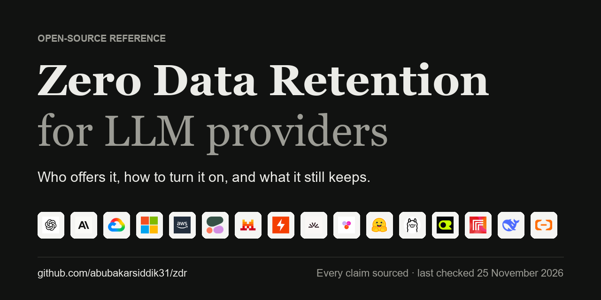

# Zero Data Retention (ZDR) for LLM Providers

**Which LLM providers offer zero data retention, how to turn it on, and what it still doesn't cover.**

16 providers · checked against their own docs · last checked 25 November 2026

[Providers](#provider-guides) · [Which approach?](#which-approach-fits) · [Topic guides](#topic-guides) · [What changed in 2026](#what-changed-in-2026)

> [!NOTE]
> Provider terms changed a lot in 2026 and will keep changing. Every page links to the provider's own documentation. Check the linked source before you rely on a detail.

## Provider guides

One page per provider: defaults, how to turn ZDR on, exceptions, how to check it, and numbered sources.

**ZDR availability:** *Default* means nothing is retained out of the box. *Self-serve* means you can turn it on yourself. *On request* means sales or an account team has to approve it. *Not available* means the provider offers no ZDR option.

### Frontier and cloud

| | Provider | Default retention | ZDR |
| :-: | :--- | :--- | :--- |
|  | [**OpenAI**](providers/openai.md) | Abuse logs up to 30 days | On request |
|  | [**Anthropic**](providers/anthropic.md) | Deleted within 30 days | On request |
|  | [**Google Vertex AI**](providers/google-vertex-ai.md) | 24h cache; flagged prompts up to 90 days | On request |
|  | [**Azure OpenAI**](providers/azure-openai.md) | Flagged content can be stored for review | On request, ending for models from 1 Nov 2026 |
|  | [**AWS Bedrock**](providers/aws-bedrock.md) | Most models keep nothing; some keep up to 30 days | Self-serve |
|  | [**Cohere**](providers/cohere.md) | 30 days; training is opt-out | On request |

### Open-model inference

| | Provider | Default retention | ZDR |
| :-: | :--- | :--- | :--- |
|  | [**Fireworks AI**](providers/fireworks-ai.md) | Nothing stored for open models | Default |
|  | [**Together AI**](providers/together-ai.md) | ZDR for new organizations | Self-serve |
|  | [**Groq**](providers/groq.md) | Logs up to 30 days | Self-serve |
|  | [**Mistral AI**](providers/mistral-ai.md) | 30 rolling days | On request |
|  | [**Hugging Face**](providers/hugging-face-inference-endpoints.md) | No payloads stored; logs 30 days | Default |
|  | [**Ollama**](providers/ollama.md) | Local: stays on your machine; Cloud: not logged | Default |

### Gateways and others

| | Provider | Default retention | ZDR |
| :-: | :--- | :--- | :--- |
|  | [**OpenRouter**](providers/openrouter.md) | Prompts not logged unless you opt in | Self-serve |
| | [**Other AI gateways**](providers/gateways.md) | Depends on the gateway | Depends |
|  | [**Replicate**](providers/replicate.md) | API predictions deleted after 1 hour | Not available |
|  | [**DeepSeek API**](providers/chinese-and-international.md) | Kept while the account exists, stored in China | Not available |
|  | [**Alibaba Model Studio**](providers/chinese-and-international.md) | Up to 30 days | On request |

## Which approach fits

| Approach | Who can see the data | Models | Effort |
| :--- | :--- | :--- | :--- |
| [Self-hosted](docs/self-hosting.md) | Only you | Open weights | High |
| [Cloud AI service, private network](docs/architectures.md#1-a-cloud-provider-over-a-private-network) | The cloud provider, under contract | Frontier and open | Medium |
| Provider API with ZDR | The provider, during the request | That provider's models | Low |
| Open-model host with ZDR | The host, during the request | Open weights | Low |
| [Gateway](providers/gateways.md) | The gateway and each provider | Many | Low to medium |

## Topic guides

| Guide | What it covers |
| :--- | :--- |
| [Threat model](docs/threat-model.md) | What ZDR protects against, and where your prompts actually go |
| [Self-hosting](docs/self-hosting.md) | When to do it, models, frameworks, hardware sizing, hardening |
| [Compliance](docs/compliance.md) | HIPAA (BAAs), SOC 2, GDPR, FedRAMP |
| [Beyond ZDR](docs/beyond-zdr.md) | PII redaction, proxies, your own logging, prompt injection |
| [Verification](docs/verification.md) | The evidence an auditor will ask for |
| [Architectures](docs/architectures.md) | Private networking, self-hosted stacks, gateways, a HIPAA reference design |

## What changed in 2026

- New frontier models now require retention. Anthropic's Claude Fable and Mythos lines need 30-day retention unless you use Enterprise Frontier Safeguards. Bedrock and Vertex AI apply similar rules.
- AWS Bedrock replaced "nothing is stored" with an explicit retention mode. Set it to `none` yourself.
- Microsoft is ending Modified Abuse Monitoring for Azure models released on or after 1 November 2026.
- OpenAI added Private Safety Processing, and data residency now covers ten regions.
- Together AI disclosed that stored prompt samples were downloaded by an unauthorized party, and made ZDR the default for new organizations.

## In-depth guides

Longer write-ups on my site:

- [Zero Data Retention (ZDR) for LLM Providers](https://abubakar-siddik.com/guides/zero-data-retention-llm-providers): the full guide in one page, with a contents panel
- [Fireworks AI ZDR: how to set it up without missing the exceptions](https://abubakar-siddik.com/guides/fireworks-ai-zero-data-retention)

More are listed at [abubakar-siddik.com/guides](https://abubakar-siddik.com/guides).

## Maintainer

Maintained by [Abu Bakar Siddik](https://abubakar-siddik.com/about), an AI engineer who builds private LLM systems. I check providers' terms when they change and write up the tricky ones in more depth.

Hearing about real setups keeps this reference accurate. If you hit an edge case these pages don't answer, [open an issue](https://github.com/abubakarsiddik31/zdr/issues) or [write to me](mailto:theabubakarsiddik@gmail.com?subject=ZDR%20question).

## Contributing

Corrections and new providers are welcome. See [CONTRIBUTING.md](CONTRIBUTING.md). Please link the official source for every claim, note the date you checked it, and test any code before submitting.

## License

Licensed under the Apache License, Version 2.0. See [LICENSE](LICENSE).
