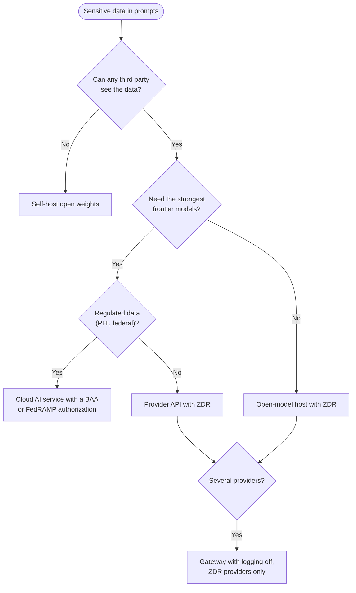

# Zero Data Retention (ZDR) for LLM Providers

A practical reference for keeping your data private when you use LLM APIs: which providers offer zero data retention, how to turn it on, what it doesn't cover, and how to show an auditor it is in place. Every page links to the provider's own documentation.

> **Last checked:** 25 November 2026. Provider terms changed a lot in 2026, and they will keep changing. Check the linked source before you rely on a detail. A [web version](https://abubakar-siddik.com/guides/zero-data-retention-llm-providers) lives on my site.

## Contents

- [Quick answer: who offers ZDR](#quick-answer-who-offers-zdr)
- [What changed in 2026](#what-changed-in-2026)
- [Which approach fits](#which-approach-fits)
- [Providers](#providers)
- [Topics](#topics)
- [In-depth guides](#in-depth-guides)
- [Maintainer](#maintainer)
- [Contributing](#contributing)

## Quick answer: who offers ZDR

A summary of each provider page. The details and exceptions are on the page.

| Provider | Default | Zero retention | How you get it |
| :--- | :--- | :--- | :--- |
| [OpenAI](providers/openai.md) | Abuse logs up to 30 days | ZDR, Modified Abuse Monitoring, Private Safety Processing | Approval through sales |
| [Anthropic](providers/anthropic.md) | Deleted within 30 days | Legacy ZDR; Enterprise Frontier Safeguards for models that need retention | Sales; EFS by request (beta) |
| [Google Vertex AI](providers/google-vertex-ai.md) | 24h cache; flagged prompts up to 90 days | Disable cache, abuse-logging exemption | API call plus Master Agreement or account team |
| [Azure OpenAI](providers/azure-openai.md) | Flagged content can be stored for human review | Modified Abuse Monitoring, not for models released from 1 Nov 2026 | Application form, managed customers |
| [AWS Bedrock](providers/aws-bedrock.md) | Most models keep nothing; Claude Fable and most OpenAI models keep data up to 30 days | Retention mode `none`; per-model ZDR approval | API setting; account team for some models |
| [Cohere](providers/cohere.md) | 30 days; training is opt-out | Enterprise ZDR | Email support with your sales rep |
| [Mistral AI](providers/mistral-ai.md) | 30 rolling days | ZDR for stateless endpoints | Request with a reason, pay-as-you-go |
| [Groq](providers/groq.md) | Logs up to 30 days for troubleshooting | ZDR | Self-serve in Data Controls |
| [Fireworks AI](providers/fireworks-ai.md) | Nothing stored for open models | Default; enterprise ZDR policy enforces it | Default |
| [Together AI](providers/together-ai.md) | ZDR for new organizations | Prompt storage off | Self-serve in Organization Settings |
| [Hugging Face](providers/hugging-face-inference-endpoints.md) | No payloads stored; logs 30 days | No separate setting | Not applicable |
| [Ollama](providers/ollama.md) | Local: never leaves your machine; Cloud: not logged | Default | Default |
| [Replicate](providers/replicate.md) | API predictions deleted after 1 hour | None | Not available |
| [OpenRouter](providers/openrouter.md) | Prompts not logged unless you opt in | ZDR routing per model group or per request | Self-serve |
| [DeepSeek API](providers/chinese-and-international.md) | Kept while the account exists, stored in China | None; use a ZDR host or self-host | Not available |
| [Alibaba Model Studio](providers/chinese-and-international.md) | Up to 30 days | ZDR per workspace | International site, enterprise |

## What changed in 2026

- Some new frontier models now require retention. Anthropic's Claude Fable and Mythos lines need 30-day retention unless you use Enterprise Frontier Safeguards, which keeps encrypted copies in your own bucket. Bedrock and Vertex AI apply similar rules to these models.
- AWS Bedrock replaced "nothing is stored" with an explicit retention mode. Set it to `none` yourself.
- Microsoft is ending Modified Abuse Monitoring for Azure models released on or after 1 November 2026.
- OpenAI added Private Safety Processing, and its data residency now covers ten regions.
- Together AI disclosed that stored prompt samples were downloaded by an unauthorized party, and made ZDR the default for new organizations.

## Which approach fits

| Approach | Who can see the data | Models | Effort |
| :--- | :--- | :--- | :--- |
| [Self-hosted](docs/self-hosting.md) | Only you | Open weights | High |
| [Cloud AI service, private network](docs/architectures.md#1-a-cloud-provider-over-a-private-network) | The cloud provider, under contract | Frontier and open | Medium |
| Provider API with ZDR | The provider, during the request | That provider's models | Low |
| Open-model host with ZDR | The host, during the request | Open weights | Low |
| [Gateway](providers/gateways.md) | The gateway and each provider | Many | Low to medium |

## Providers

One page per provider: default retention, how to enable ZDR, what is and isn't covered, and code where it helps.

| Frontier and cloud | Open-model inference | Gateways and others |
| :--- | :--- | :--- |
| [OpenAI](providers/openai.md) | [Fireworks AI](providers/fireworks-ai.md) | [OpenRouter](providers/openrouter.md) |
| [Anthropic](providers/anthropic.md) | [Together AI](providers/together-ai.md) | [Other AI gateways](providers/gateways.md) |
| [Google Vertex AI](providers/google-vertex-ai.md) | [Groq](providers/groq.md) | [Replicate](providers/replicate.md) |
| [Azure OpenAI](providers/azure-openai.md) | [Hugging Face Inference Endpoints](providers/hugging-face-inference-endpoints.md) | [Chinese and international providers](providers/chinese-and-international.md) |
| [AWS Bedrock](providers/aws-bedrock.md) | [Mistral AI](providers/mistral-ai.md) | |
| [Cohere](providers/cohere.md) | [Ollama (local and cloud)](providers/ollama.md) | |

## Topics

- [Threat model](docs/threat-model.md): what ZDR protects against, and where your prompts actually go
- [Self-hosting open-weight models](docs/self-hosting.md): when to do it, models, frameworks, hardware sizing, hardening
- [Compliance mapping](docs/compliance.md): HIPAA (BAAs), SOC 2, GDPR, FedRAMP
- [Data protection beyond ZDR](docs/beyond-zdr.md): PII redaction, proxies, your own logging, prompt injection
- [Verification and audit](docs/verification.md): the evidence an auditor will ask for
- [Architecture blueprints](docs/architectures.md): private networking, self-hosted stacks, gateways, a HIPAA reference design

## In-depth guides

Longer, step-by-step write-ups on my site:

- [Zero Data Retention (ZDR) for LLM Providers](https://abubakar-siddik.com/guides/zero-data-retention-llm-providers): the full guide in one page
- [Fireworks AI ZDR: how to set it up without missing the exceptions](https://abubakar-siddik.com/guides/fireworks-ai-zero-data-retention)

More are on the way; they are listed at [abubakar-siddik.com/guides](https://abubakar-siddik.com/guides).

## Maintainer

Maintained by [Abu Bakar Siddik](https://abubakar-siddik.com/about), an AI engineer who builds private LLM systems. I check providers' terms when they change and write up the tricky ones in more depth.

Hearing about real setups is what keeps this reference accurate. If you're working through one and hit an edge case these pages don't answer, [open an issue](https://github.com/abubakarsiddik31/zdr/issues) or [write to me](mailto:theabubakarsiddik@gmail.com?subject=ZDR%20question).

## Contributing

Corrections and new providers are welcome. See [CONTRIBUTING.md](CONTRIBUTING.md). Please:

- link the official source for every claim
- note the date you checked it
- test any code before submitting

## License

Licensed under the Apache License, Version 2.0. See [LICENSE](LICENSE).
