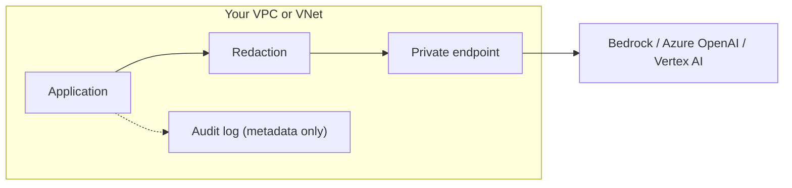
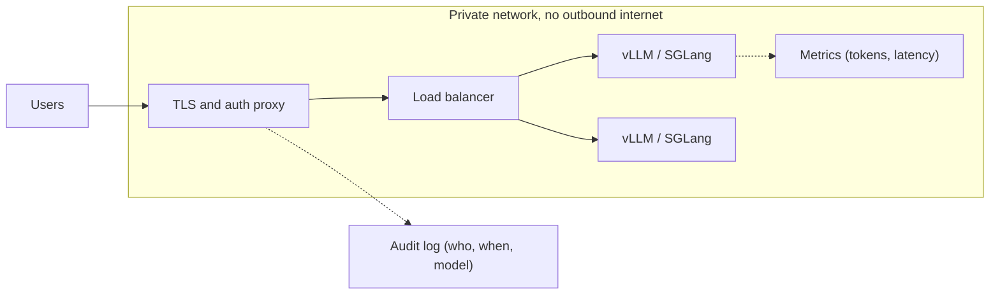
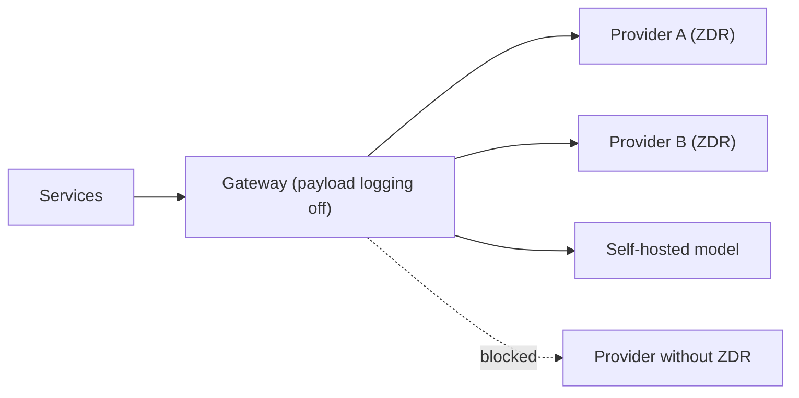
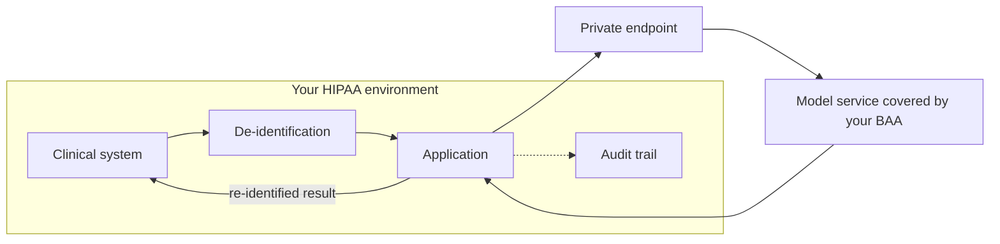

# Architecture Blueprints for Private LLM Use

> Part of [Zero Data Retention (ZDR) for LLM Providers](../README.md) · Last checked: 25 November 2026 · [Web version](https://abubakar-siddik.com/guides/zero-data-retention-llm-providers#architecture-blueprints)

Four common setups, from least to most effort to run. Each one names the controls that make it private and what it still depends on. Pick by your [threat model](threat-model.md), not by which diagram looks most secure.

## 1. A cloud provider over a private network

Frontier or open models through your cloud provider's AI service, reached over a private endpoint, with retention turned off in the account.

What makes it private:

- [AWS Bedrock](../providers/aws-bedrock.md): data retention mode `none` in every Region and project, enforced with an SCP, and a PrivateLink interface endpoint.
- [Azure OpenAI](../providers/azure-openai.md): Modified Abuse Monitoring approved (for models released before 1 November 2026), a private endpoint, and public network access disabled.
- [Google Vertex AI](../providers/google-vertex-ai.md): caching disabled, the abuse-logging exemption, and VPC Service Controls.

What it still depends on: the cloud provider's terms, and which models you pick. Some models require retention (the Claude Fable line on Bedrock, Advanced AI models on Vertex).

## 2. Self-hosted

Open-weight models on your own GPUs. Nothing leaves your network.

What makes it private: the model runs on hardware you control, with no outbound access and authentication in front of it. See [Self-hosting](self-hosting.md).

What it still depends on: your own logging and access control. Model quality is capped at what open weights offer.

## 3. One gateway, several providers

A gateway gives every service one endpoint and routes to providers that are all on ZDR.

What makes it private: payload logging off in the gateway, and routing limited to providers you have verified. A self-hosted LiteLLM proxy with an allowlist of models does this inside your network. [OpenRouter](../providers/openrouter.md) does it as a hosted service with per-request `zdr: true`. See [AI gateways](../providers/gateways.md).

What it still depends on: every upstream provider's ZDR, plus the gateway itself. It sees everything.

## 4. Healthcare (HIPAA)

PHI stays in your environment. De-identified text goes to a model covered by a BAA.

What makes it compliant: a BAA that names the service, only BAA-eligible features in use, and de-identification before the prompt is built. Anthropic's HIPAA readiness enforces the feature list for you by rejecting non-eligible features. See [Compliance mapping](compliance.md).

What it still depends on: how good the de-identification is, and the audit trail on your side.

---

[← Back to the guide](../README.md) · Spotted a change in this page? [Open an issue](https://github.com/abubakarsiddik31/zdr/issues/new) with a link to the source.
