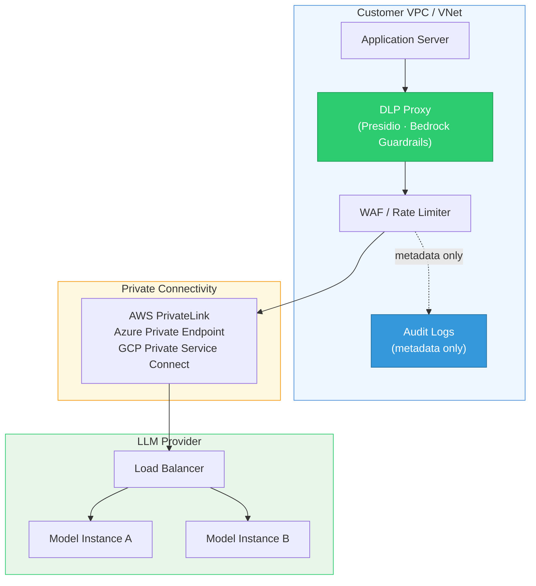
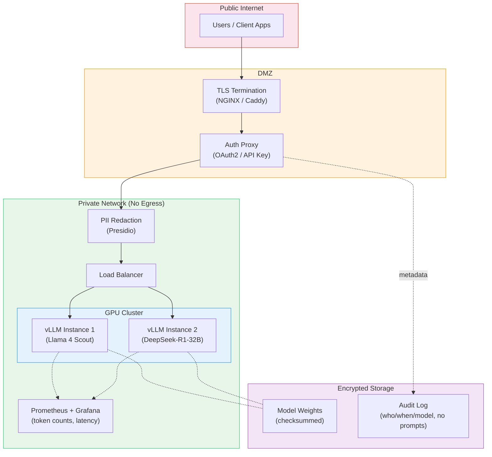
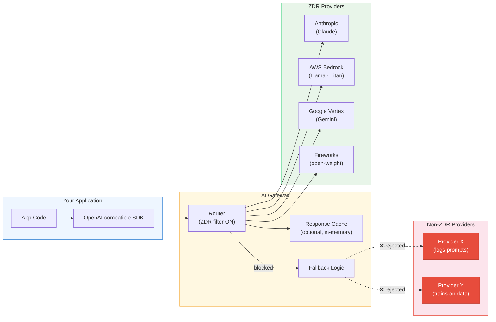
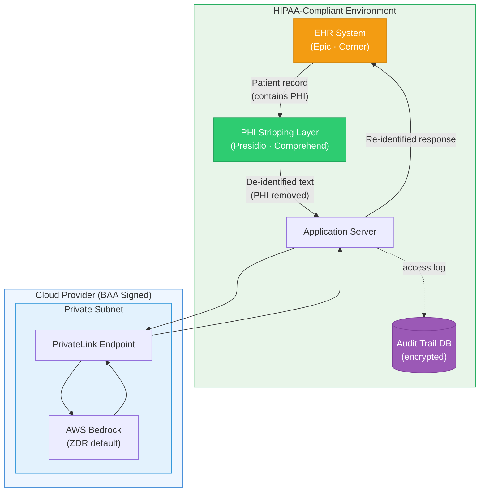

# Architecture Blueprints for Private LLM Use

> Part of [Zero Data Retention (ZDR) for LLM Providers](../README.md) · Last checked: April 2026 · [Web version](https://abubakar-siddik.com/guides/zero-data-retention-llm-providers#architecture-blueprints)

## 1. Cloud ZDR with Private Networking

The enterprise standard: frontier models via private network, no data on public internet.

## 2. Self-Hosted Production Stack

Maximum privacy: everything runs on your infrastructure, nothing leaves.

## 3. Gateway-Based Multi-Provider ZDR

Route to the best model while enforcing ZDR across all providers.

## 4. Compliance-Ready Healthcare Architecture (HIPAA)

---

[← Back to the guide](../README.md) · Spotted a change in this page? [Open an issue](https://github.com/abubakarsiddik31/zdr/issues/new) with a link to the source.
