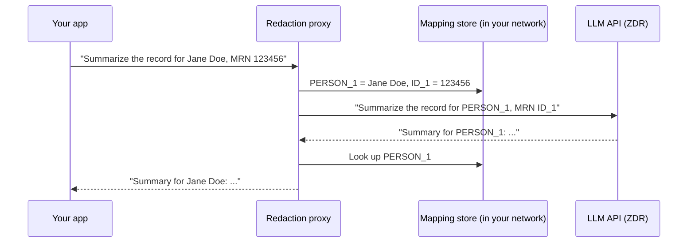

# Data Protection Beyond ZDR

> Part of [Zero Data Retention (ZDR) for LLM Providers](../README.md) · Last checked: 25 November 2026 · [Web version](https://abubakar-siddik.com/guides/zero-data-retention-llm-providers#data-protection-beyond-zdr)

ZDR stops the provider from keeping your data. It does nothing about your own systems, which see every prompt first. The gaps are often on your own side: request logging, error trackers, tracing tools and gateways that keep full prompts. This page covers redacting data before it leaves, your own logs, and prompt injection.

## Redact before the request leaves

If the model doesn't need a name, an ID number or an email address to do the task, remove it before the prompt is built. Then a retention gap anywhere downstream exposes less.

| Tool | Type | Notes |
| :--- | :--- | :--- |
| [Microsoft Presidio](https://github.com/microsoft/presidio) | Open source | Detects and anonymizes PII with named-entity recognition, patterns and checksums. Runs in your network. |
| [LiteLLM PII masking](https://docs.litellm.ai/docs/proxy/guardrails/pii_masking_v2) | Open source proxy | Runs Presidio as a guardrail on requests going through the LiteLLM proxy. [1] |
| [Amazon Bedrock Guardrails](https://docs.aws.amazon.com/bedrock/latest/userguide/guardrails.html) | Managed | Sensitive-information filters can block or mask PII in prompts and responses. [2] |
| [Amazon Comprehend PII detection](https://docs.aws.amazon.com/comprehend/latest/dg/how-pii.html) | Managed | Detection and redaction API. [3] |
| [Google Sensitive Data Protection](https://cloud.google.com/sensitive-data-protection) | Managed | Detection, masking and reversible tokenization. [4] |
| [LLM Guard](https://github.com/protectai/llm-guard) | Open source | Scanners for PII and prompt injection. The repository is archived, so plan for no further updates. |

Managed services see the data in order to redact it. Make sure they fall under the same agreement and region as the rest of your setup.

## Redaction with re-identification

When the response has to mention the real values, swap them for placeholders on the way out and restore them on the way back. The mapping stays in your network.

Keep the mapping store short-lived, with its own access controls. Otherwise it becomes the most sensitive database you have.

## Your own logging

| Where | Typical problem | What to do |
| :--- | :--- | :--- |
| Web framework and HTTP client | Request bodies logged at debug level. | Log metadata only in production. |
| Error tracking (Sentry and similar) | Request payloads attached to exceptions. | Scrub fields before events are sent. [5] |
| LLM tracing (Langfuse, LangSmith and similar) | Full prompts and completions stored by default. | Use the tool's masking feature, or self-host it. [6] |
| Gateways and proxies | Request and response bodies logged by default. | Turn off payload logging. See [AI gateways](../providers/gateways.md). |
| Load balancers and WAFs | Body capture for debugging. | Keep body logging off. |
| Databases | Prompts stored with chat history. | Encrypt, set a retention period, and include the store in deletion requests. |
| Browsers | Prompts in local storage or analytics events. | Redact on the server, and keep prompts out of analytics. |

## Prompt injection and exfiltration

If the model can call tools or its output is rendered, text it reads can instruct it to leak data. OWASP ranks prompt injection first in its LLM Top 10. [7]

- Give the model only the tools the task needs, with the narrowest permissions.
- Require a human to approve actions that send data out: email, HTTP requests, database writes.
- Don't render model output as live HTML or Markdown. An image link like `` leaks data when a browser loads it.
- Treat retrieved documents, web pages and tool results as untrusted input.
- Check tool arguments for data the current task shouldn't need.

## Sources

1. LiteLLM, [PII masking with Presidio](https://docs.litellm.ai/docs/proxy/guardrails/pii_masking_v2). Accessed 25 November 2026.
2. AWS, [Amazon Bedrock Guardrails](https://docs.aws.amazon.com/bedrock/latest/userguide/guardrails.html). Accessed 25 November 2026.
3. AWS, [Detecting PII entities with Amazon Comprehend](https://docs.aws.amazon.com/comprehend/latest/dg/how-pii.html). Accessed 25 November 2026.
4. Google Cloud, [Sensitive Data Protection](https://cloud.google.com/sensitive-data-protection). Accessed 25 November 2026.
5. Sentry, [Scrubbing sensitive data](https://docs.sentry.io/platforms/python/data-management/sensitive-data/). Accessed 25 November 2026.
6. Langfuse, [Masking](https://langfuse.com/docs/observability/features/masking). Accessed 25 November 2026.
7. OWASP, [LLM01: Prompt injection](https://genai.owasp.org/llmrisk/llm01-prompt-injection/). Accessed 25 November 2026.

---

[← Back to the guide](../README.md) · Spotted a change in this page? [Open an issue](https://github.com/abubakarsiddik31/zdr/issues/new) with a link to the source.
