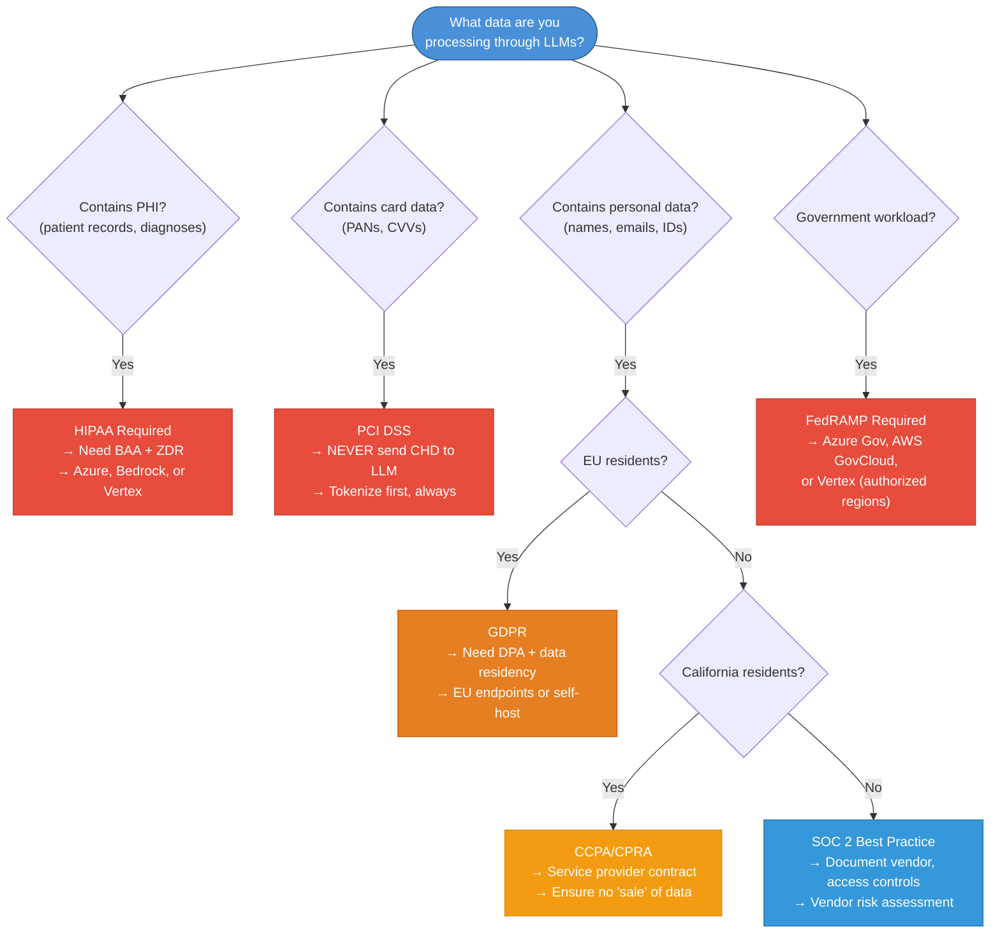

# Compliance Mapping: HIPAA, SOC 2, GDPR, FedRAMP

> Part of [Zero Data Retention (ZDR) for LLM Providers](../README.md) · Last checked: April 2026 · [Web version](https://abubakar-siddik.com/guides/zero-data-retention-llm-providers#compliance-mapping)

## HIPAA (Healthcare)

To use LLMs with Protected Health Information (PHI), you need a **Business Associate Agreement (BAA)** with the provider.

| Provider | BAA Available | Notes |
| :--- | :--- | :--- |
| **Azure OpenAI** | Yes | Covered under Microsoft's healthcare compliance framework |
| **AWS Bedrock** | Yes | Bedrock is HIPAA-eligible. BAA covers all foundation models |
| **Google Vertex AI** | Yes | Vertex AI is on Google's HIPAA-eligible services list |
| **Anthropic** | Yes | Covers first-party API + HIPAA-ready Enterprise plan only. Not: Free, Pro, Max, Team |
| **Fireworks AI** | Yes | SOC 2 Type II + HIPAA compliant |
| **Together AI** | Yes | HIPAA compliant with BAA |
| **Self-hosted** | N/A | You are the business associate — ensure your infra is HIPAA-compliant |

> **"HIPAA eligible" vs. "HIPAA compliant"**: A provider being HIPAA-eligible means they'll sign a BAA. It does NOT mean using their API automatically makes your implementation compliant. You must still implement appropriate safeguards (encryption, access controls, audit logs, etc.).

## SOC 2 Type II

Most major providers are SOC 2 Type II certified: OpenAI, Anthropic, Azure, AWS, Google Cloud, Fireworks, Together AI, Cohere, Hugging Face, Groq.

## GDPR

- **Data residency**: OpenAI offers EU endpoints (`eu.api.openai.com`). Azure, AWS, and GCP all support regional deployment
- **DPA**: Most providers offer Data Processing Addendums/Agreements. Mistral (EU-headquartered) processes data in the EU by default
- **Right to erasure**: Under ZDR, data is already not retained — simplifying DSAR responses
- **Training opt-out**: All API-tier providers listed here either don't train on API data by default or offer opt-out

## FedRAMP

| Provider | FedRAMP Status |
| :--- | :--- |
| **Azure OpenAI** (Azure Government) | FedRAMP High |
| **AWS Bedrock** (GovCloud) | FedRAMP High |
| **Google Vertex AI** | FedRAMP authorized (select regions) |

---

[← Back to the guide](../README.md) · Spotted a change in this page? [Open an issue](https://github.com/abubakarsiddik31/zdr/issues/new) with a link to the source.
