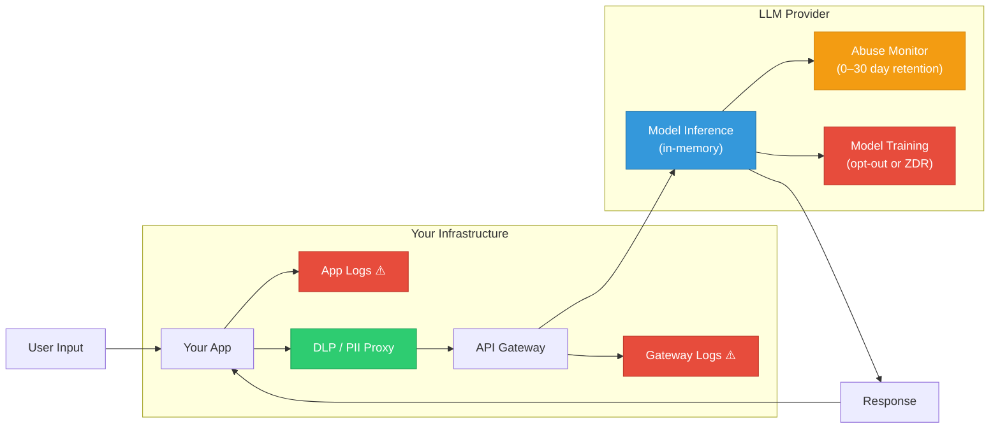

# Threat Model for LLM Data Retention

> Part of [Zero Data Retention (ZDR) for LLM Providers](../README.md) · Last checked: April 2026 · [Web version](https://abubakar-siddik.com/guides/zero-data-retention-llm-providers#threat-model)

Before choosing an approach, understand what you're protecting against:

| Threat | Description | Mitigated By |
| :--- | :--- | :--- |
| **Training data leakage** | Your prompts/outputs used to train the provider's models | ZDR contract, API-tier (not free-tier), self-hosting |
| **Abuse monitoring retention** | Provider stores prompts for safety review (often 30 days) | ZDR/MAM opt-out, self-hosting |
| **Employee access** | Provider staff can view your data during incident response | ZDR + BYOK encryption, self-hosting |
| **Subpoena / legal discovery** | Government or legal requests to the provider for your data | Self-hosting, data residency controls, no-retention contract |
| **Breach at provider** | Provider's systems compromised, your data exfiltrated | No-retention (nothing to steal), self-hosting, encryption at rest |
| **Your own logging** | Your infra (proxies, APM, error trackers) logs sensitive prompts | DLP proxy, log redaction, audit your pipeline |
| **Prompt injection exfiltration** | Malicious input causes LLM to leak data via tool calls | Output scanning, least-privilege tools, sandboxing |

## Data Lifecycle: Where Your Prompts Go

> Red = risk points where data can be retained. Green = protection layer. ZDR eliminates the provider-side risks; DLP/proxy eliminates your-side risks.

---

[← Back to the guide](../README.md) · Spotted a change in this page? [Open an issue](https://github.com/abubakarsiddik31/zdr/issues/new) with a link to the source.
