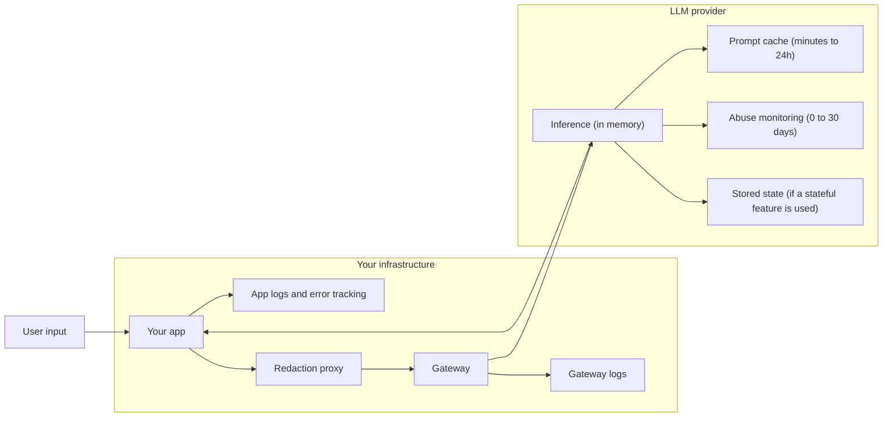

# Threat Model for LLM Data Retention

> Part of [Zero Data Retention (ZDR) for LLM Providers](../README.md) · Last checked: 25 November 2026 · [Web version](https://abubakar-siddik.com/guides/zero-data-retention-llm-providers#threat-model)

Before choosing a provider setting, write down what you are protecting against. "We need ZDR" often turns out to mean "we can't have our data used for training", which most paid APIs already promise. Or it means "nothing can be stored anywhere", which ZDR alone doesn't deliver, because your own systems store plenty.

## What can go wrong

| Risk | What it looks like | What reduces it |
| :--- | :--- | :--- |
| Training on your data | Prompts or outputs used to train the provider's models. | Paid API terms (most don't train by default), training opt-outs, self-hosting. Check: Mistral's Labs models and DeepSeek's terms are exceptions. |
| Abuse-monitoring retention | The provider keeps prompts for safety review, often up to 30 days. | ZDR or an equivalent exemption, self-hosting. |
| Human review at the provider | Flagged content is read by the provider's staff. | Modified abuse monitoring, programs that move review to your own team (Anthropic EFS, OpenAI Private Safety Processing), self-hosting. |
| Stateful features | Conversation stores, files, batch jobs, agent sessions and code containers keep data by design. | Avoiding those features, or using `store=false` where it exists. |
| Breach at the provider | Stored data is stolen. | Not storing it in the first place. Together AI's 2026 incident involved stored prompt samples. |
| Legal requests | A court or government asks the provider for your data. | Not storing it, data residency, self-hosting. |
| Your own logging | Your proxy, APM, error tracker or LLM tracing tool keeps the full prompt. | Redaction, log configuration, audits. Often the biggest gap. |
| Prompt injection | Content the model reads tells it to send data somewhere. | Least-privilege tools, output checks, human approval for risky actions. |

Provider ZDR handles the second, fifth and sixth rows for data on the provider's side. The rest need other controls.

## Where prompts go

Every box outside "Inference" is a place data can stay. Prompt caches are usually short-lived and in memory, and most providers treat them as compatible with ZDR. Check the provider page for the exact window.

## Questions to answer before choosing

1. What kinds of data will be in prompts: PHI, personal data, source code, trade secrets?
2. Which regulation or contract applies to each kind? See [Compliance mapping](compliance.md).
3. Is retention for abuse monitoring acceptable if no human reviews it? If a human reviews it?
4. Which provider features do you actually need? Batch, files, agents and conversation storage usually fall outside ZDR.
5. Where is your own logging, and who can read it?
6. What evidence will an auditor ask for? See [Verification and audit](verification.md).

---

[← Back to the guide](../README.md) · Spotted a change in this page? [Open an issue](https://github.com/abubakarsiddik31/zdr/issues/new) with a link to the source.
