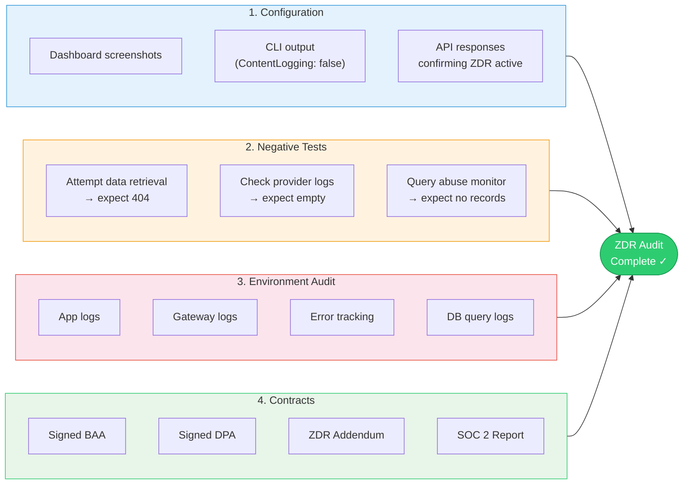

# Verifying and Auditing a ZDR Setup

> Part of [Zero Data Retention (ZDR) for LLM Providers](../README.md) · Last checked: April 2026 · [Web version](https://abubakar-siddik.com/guides/zero-data-retention-llm-providers#verification--audit-guide)

A credible ZDR audit requires **Four Pillars of Evidence**:



## 1. Configuration Artifacts

Capture proof that ZDR is enabled:

```bash
# Azure OpenAI — verify ContentLogging is disabled
az cognitiveservices account show --name <resource> --resource-group <rg> \
  --query "properties.capabilities[?name=='ContentLogging'].value"
# Expected: "false"

# AWS Bedrock — verify no logging configured
aws bedrock get-model-invocation-logging-configuration
# Expected: empty or no cloudwatch/s3 config

# OpenAI — screenshot Dashboard > Settings > Organization > Data Retention showing ZDR enabled
```

## 2. Negative Tests

Attempt to retrieve data that shouldn't exist:

```bash
# OpenAI — attempt to retrieve a completion (should fail under ZDR)
curl https://api.openai.com/v1/chat/completions/<completion-id> \
  -H "Authorization: Bearer $OPENAI_API_KEY"
# Expected: 404 or error

# AWS Bedrock — check CloudWatch for model invocation logs
aws logs filter-log-events \
  --log-group-name "/aws/bedrock/modelinvocations" \
  --start-time $(date -d '1 hour ago' +%s000)
# Expected: empty or log group doesn't exist
```

## 3. Environment Audit

Ensure YOUR infrastructure isn't logging what you're trying to protect:

- [ ] Web framework request body logging — disabled or post-redaction only
- [ ] HTTP client libraries — set to WARN+ log level in production
- [ ] API gateway / load balancer — configured to not log request bodies
- [ ] Error tracking (Sentry, Datadog) — `before_send` hooks strip sensitive fields
- [ ] LLM observability tools (LangSmith, Langfuse) — PII redaction enabled
- [ ] Database query logging — parameterized queries, no full statement logging
- [ ] WAF / DLP proxy — not storing payloads in its own logs

## 4. Contractual Proof

Collect signed agreements:
- [ ] BAA (Business Associate Agreement) — for HIPAA
- [ ] DPA (Data Processing Agreement/Addendum) — for GDPR
- [ ] ZDR Addendum or Amendment — provider-specific
- [ ] SOC 2 Type II report — from the provider's trust center

---

[← Back to the guide](../README.md) · Spotted a change in this page? [Open an issue](https://github.com/abubakarsiddik31/zdr/issues/new) with a link to the source.
